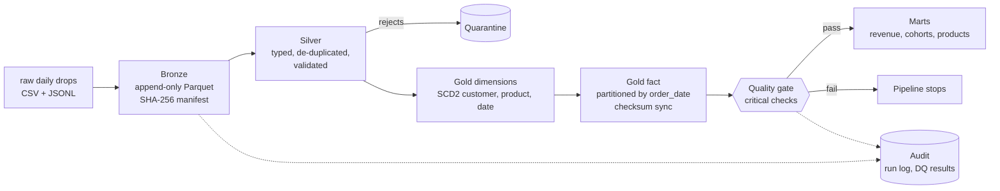

# Retail Lakehouse ELT

A medallion-architecture (bronze, silver, gold) ELT pipeline built on **DuckDB and Parquet**. It ingests messy daily source drops exactly once, cleans and validates them, models them as a star schema with **SCD Type 2** history, and publishes analytics marts only after the data passes **quality gates**.

> **About the data.** All source data is **synthetic**, produced by `lakehouse generate`. It is deliberately defective in the ways real source systems are (duplicates, late arrivals, invalid records, changing dimensions, schema drift) so the engineering has something real to solve. The pipeline code is the project, not the dataset.

## Architecture



## Quick start

```bash
pip install -r requirements.txt
export PYTHONPATH=src
python -m lakehouse generate --root lake        # 14 daily drops of synthetic data
python -m lakehouse run --root lake             # bronze -> silver -> gold -> quality -> marts
python -m lakehouse report --root lake          # last run, quality results, mart sample
python -m pytest -q                             # 8 tests
```

Simulate days arriving over time: `python -m lakehouse run --root lake --through 2026-01-06`, then run again without `--through`.

## Engineering problems this solves

| Problem | Solution | Code | Test |
|---|---|---|---|
| A retry or re-run must not double-load data | Manifest keyed by SHA-256 of each source file; exactly-once ingestion | `bronze.py` | `test_rerun_is_idempotent` |
| Source re-sends the same order | First arrival wins, duplicates counted and dropped | `silver.py` | `test_duplicates_removed_and_bad_records_quarantined` |
| Invalid records | Rule-based validation; rejects go to a quarantine table with the rule broken, never silently dropped | `silver.py` | same as above |
| New columns appear mid-stream | `union_by_name` reads plus column-presence checks absorb schema drift | `bronze.py`, `silver.py` | `test_schema_drift_is_absorbed` |
| Customer attributes change over time | SCD Type 2 with validity windows and a deterministic surrogate key | `gold.py` | `test_scd2_history_is_contiguous` |
| Reports must use the attribute the customer had **at order time** | Point-in-time join of facts to the dimension version | `gold.py` | `test_point_in_time_join` |
| Orders arrive days after they happened | Facts land in their event-date partition, flagged `is_late` | `silver.py`, `gold.py` | `test_late_arrivals_land_in_their_event_date_partition` |
| Incremental load must equal a full rebuild | Partitions are rewritten only when their content checksum changes | `gold.py` | `test_incremental_equals_full_refresh` |
| Bad data must not reach consumers | Critical quality checks run **before** marts are published | `quality.py`, `pipeline.py` | `test_quality_gate_catches_corruption` |
| Operability | DAG ordering, retries with backoff, per-task run log and DQ history | `pipeline.py` | n/a |

## Defects injected into the synthetic source

About 3% of orders are re-sent the next day, 2% arrive 2 to 5 days late, 2% are invalid (zero or negative quantity, missing customer, unknown SKU), 1% of customer emails are malformed, 3% of customers change city or segment each day, `coupon_code` appears in the orders from day 8, and `loyalty_tier` appears in the customers from day 10.

## Measured results

Measured in a single-core sandbox container; reproduce with the commands above.

| Run | Input | Output | Time |
|---|---|---|---|
| Default (`generate`) | 24,605 bronze rows, 21,585 raw orders | 51,114 order lines, 19 partitions, 9 quality checks passed | about 2.4 s |
| Large (`--days 20 --customers 50000 --orders-per-day 25000`) | 514,250 raw orders | 1,218,879 order lines, 14,250 duplicates removed, 12,581 orders quarantined | about 10.6 s cold |
| Re-run, nothing new | 42 files already loaded | 0 files ingested, 0 partitions rewritten | about 5.1 s |

## Design decisions and trade-offs

* **DuckDB and Parquet.** Real columnar storage and full SQL on one machine, with no cluster to operate. The layout (hive-style partitions, immutable bronze) carries over to object storage.
* **Silver is rebuilt from bronze each run.** This keeps silver a pure function of what has been ingested, which makes it easy to reason about and test. The cost is that silver work grows with history.
* **The gate runs before the marts.** A failed critical check stops the run before anything downstream is published.
* **Surrogate keys are hashes**, so they stay stable when new dimension versions arrive.

## What changes at scale

This is a single-node project and says so. In production I would: make silver incremental by partition; move storage to object storage with an open table format (Iceberg or Delta); replace the DAG runner with Airflow or Dagster; move the SQL models into dbt with its own tests; handle late-arriving dimension versions with a partition re-processing window; and add streaming ingestion where freshness demands it.

## Layout

```
src/lakehouse/   generate.py bronze.py silver.py gold.py quality.py pipeline.py __main__.py
src/lakehouse/sql/marts/   daily_revenue, revenue_by_segment_asof, top_products, cohort_retention
tests/           8 tests covering idempotency, incrementality, SCD2, quality gates
.github/workflows/ci.yml   runs the tests on every push
```
