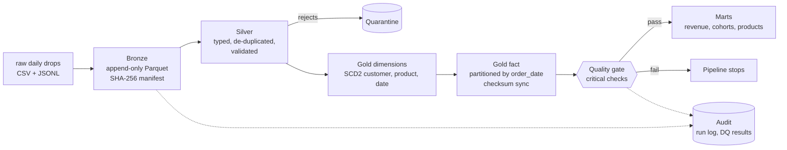

# Retail Lakehouse ELT: every file in one place
Create each file below at the path shown (GitHub: Add file, Create new file, type the path including folders, paste the content). Order does not matter.

## 1. `.github/workflows/ci.yml`

````yaml
name: tests
on: [push, pull_request]
jobs:
  test:
    runs-on: ubuntu-latest
    steps:
      - uses: actions/checkout@v4
      - uses: actions/setup-python@v5
        with:
          python-version: "3.12"
      - run: pip install -r requirements.txt
      - run: PYTHONPATH=src python -m pytest -q
````

## 2. `.gitignore`

````text
lake/
demo_big/
big.json
__pycache__/
.pytest_cache/
*.egg-info/
````

## 3. `Makefile`

````text
.PHONY: install demo test big clean
export PYTHONPATH := src
install:
	pip install -r requirements.txt
demo:
	python -m lakehouse generate --root lake
	python -m lakehouse run --root lake
	python -m lakehouse report --root lake
big:
	python -m lakehouse generate --root demo_big --days 20 --customers 50000 --orders-per-day 25000
	python -m lakehouse run --root demo_big
test:
	python -m pytest -q
clean:
	rm -rf lake demo_big
````

## 4. `README.md`

````markdown
# Retail Lakehouse ELT

A medallion-architecture (bronze, silver, gold) ELT pipeline built on **DuckDB and Parquet**. It ingests messy daily source drops exactly once, cleans and validates them, models them as a star schema with **SCD Type 2** history, and publishes analytics marts only after the data passes **quality gates**.

> **About the data.** All source data is **synthetic**, produced by `lakehouse generate`. It is deliberately defective in the ways real source systems are (duplicates, late arrivals, invalid records, changing dimensions, schema drift) so the engineering has something real to solve. The pipeline code is the project, not the dataset.

## Architecture



## Quick start

```bash
pip install -r requirements.txt
export PYTHONPATH=src
python -m lakehouse generate --root lake        # 14 daily drops of synthetic data
python -m lakehouse run --root lake             # bronze -> silver -> gold -> quality -> marts
python -m lakehouse report --root lake          # last run, quality results, mart sample
python -m pytest -q                             # 8 tests
```

Simulate days arriving over time: `python -m lakehouse run --root lake --through 2026-01-06`, then run again without `--through`.

## Engineering problems this solves

| Problem | Solution | Code | Test |
|---|---|---|---|
| A retry or re-run must not double-load data | Manifest keyed by SHA-256 of each source file; exactly-once ingestion | `bronze.py` | `test_rerun_is_idempotent` |
| Source re-sends the same order | First arrival wins, duplicates counted and dropped | `silver.py` | `test_duplicates_removed_and_bad_records_quarantined` |
| Invalid records | Rule-based validation; rejects go to a quarantine table with the rule broken, never silently dropped | `silver.py` | same as above |
| New columns appear mid-stream | `union_by_name` reads plus column-presence checks absorb schema drift | `bronze.py`, `silver.py` | `test_schema_drift_is_absorbed` |
| Customer attributes change over time | SCD Type 2 with validity windows and a deterministic surrogate key | `gold.py` | `test_scd2_history_is_contiguous` |
| Reports must use the attribute the customer had **at order time** | Point-in-time join of facts to the dimension version | `gold.py` | `test_point_in_time_join` |
| Orders arrive days after they happened | Facts land in their event-date partition, flagged `is_late` | `silver.py`, `gold.py` | `test_late_arrivals_land_in_their_event_date_partition` |
| Incremental load must equal a full rebuild | Partitions are rewritten only when their content checksum changes | `gold.py` | `test_incremental_equals_full_refresh` |
| Bad data must not reach consumers | Critical quality checks run **before** marts are published | `quality.py`, `pipeline.py` | `test_quality_gate_catches_corruption` |
| Operability | DAG ordering, retries with backoff, per-task run log and DQ history | `pipeline.py` | n/a |

## Defects injected into the synthetic source

About 3% of orders are re-sent the next day, 2% arrive 2 to 5 days late, 2% are invalid (zero or negative quantity, missing customer, unknown SKU), 1% of customer emails are malformed, 3% of customers change city or segment each day, `coupon_code` appears in the orders from day 8, and `loyalty_tier` appears in the customers from day 10.

## Measured results

Measured in a single-core sandbox container; reproduce with the commands above.

| Run | Input | Output | Time |
|---|---|---|---|
| Default (`generate`) | 24,605 bronze rows, 21,585 raw orders | 51,114 order lines, 19 partitions, 9 quality checks passed | about 2.4 s |
| Large (`--days 20 --customers 50000 --orders-per-day 25000`) | 514,250 raw orders | 1,218,879 order lines, 14,250 duplicates removed, 12,581 orders quarantined | about 10.6 s cold |
| Re-run, nothing new | 42 files already loaded | 0 files ingested, 0 partitions rewritten | about 5.1 s |

## Design decisions and trade-offs

* **DuckDB and Parquet.** Real columnar storage and full SQL on one machine, with no cluster to operate. The layout (hive-style partitions, immutable bronze) carries over to object storage.
* **Silver is rebuilt from bronze each run.** This keeps silver a pure function of what has been ingested, which makes it easy to reason about and test. The cost is that silver work grows with history.
* **The gate runs before the marts.** A failed critical check stops the run before anything downstream is published.
* **Surrogate keys are hashes**, so they stay stable when new dimension versions arrive.

## What changes at scale

This is a single-node project and says so. In production I would: make silver incremental by partition; move storage to object storage with an open table format (Iceberg or Delta); replace the DAG runner with Airflow or Dagster; move the SQL models into dbt with its own tests; handle late-arriving dimension versions with a partition re-processing window; and add streaming ingestion where freshness demands it.

## Layout

```
src/lakehouse/   generate.py bronze.py silver.py gold.py quality.py pipeline.py __main__.py
src/lakehouse/sql/marts/   daily_revenue, revenue_by_segment_asof, top_products, cohort_retention
tests/           8 tests covering idempotency, incrementality, SCD2, quality gates
.github/workflows/ci.yml   runs the tests on every push
```
````

## 5. `docs/architecture.md`

````markdown
# Architecture notes

| Layer | Contents | Written by | Properties |
|---|---|---|---|
| raw | Daily CSV and JSONL drops from the source system | `generate` (stand-in for a real source) | Immutable input |
| bronze | Raw rows plus `_source_file` and `_batch_date`, as Parquet | `bronze.ingest` | Append-only, exactly-once via file hash |
| silver | Typed, de-duplicated, validated tables | `silver.build` | Deterministic function of bronze |
| quarantine | Rejected records with the rule broken | `silver.build` | Nothing is silently dropped |
| gold | Star schema: `dim_customer` (SCD2), `dim_product`, `dim_date`, `fact_order_items` | `gold.build_dims`, `gold.sync_facts` | Partitioned by `order_date`, synced by checksum |
| marts | Analytics tables built from SQL files | `gold.build_marts` | Published only after the quality gate passes |
| audit | `manifest.json`, `run_log.jsonl`, `dq_results.jsonl`, `partition_checksums.json` | all steps | Full run history |

Task order: bronze, silver, gold_dims, gold_facts, quality, marts.
````

## 6. `pyproject.toml`

````toml
[project]
name = "retail-lakehouse-elt"
version = "0.1.0"
description = "Medallion-architecture ELT pipeline on DuckDB and Parquet, with SCD2, data contracts and quality gates"
requires-python = ">=3.10"
dependencies = ["duckdb>=1.0"]

[tool.pytest.ini_options]
pythonpath = ["src"]
testpaths = ["tests"]

[build-system]
requires = ["setuptools>=68"]
build-backend = "setuptools.build_meta"

[tool.setuptools.packages.find]
where = ["src"]

[tool.setuptools.package-data]
lakehouse = ["sql/marts/*.sql"]
````

## 7. `requirements.txt`

````text
duckdb>=1.0
pytest>=8.0
````

## 8. `src/lakehouse/__init__.py`

````python

````

## 9. `src/lakehouse/__main__.py`

````python
import argparse
import json
from pathlib import Path

import duckdb

from .generate import generate
from .pipeline import run


def _report(root: Path) -> None:
    log = [json.loads(line) for line in (root / "audit" / "run_log.jsonl").read_text().splitlines()]
    last = log[-1]["run_id"]
    print(f"Last run: {last}")
    for rec in (r for r in log if r["run_id"] == last):
        print(f"  {rec['task']:<11} {rec['status']:<6} {rec.get('seconds', '-'):>7}s  {rec.get('metrics', rec.get('error'))}")
    dq = [json.loads(line) for line in (root / "audit" / "dq_results.jsonl").read_text().splitlines()]
    print("\nData quality (this run):")
    for r in (d for d in dq if d["run_id"] == last):
        print(f"  {'PASS' if r['passed'] else 'FAIL':<5} {r['severity']:<9} {r['check']:<30} value={r['value']} (limit {r['threshold']})")
    con = duckdb.connect()
    marts = root / "gold" / "marts"
    print("\nRevenue by segment, as of order time (first rows):")
    for row in con.execute(f"SELECT * FROM read_parquet('{marts}/revenue_by_segment_asof.parquet') LIMIT 6").fetchall():
        print("  ", row)


def main() -> None:
    p = argparse.ArgumentParser(prog="lakehouse")
    sub = p.add_subparsers(dest="cmd", required=True)
    g = sub.add_parser("generate", help="create synthetic raw source drops")
    g.add_argument("--root", default="lake")
    g.add_argument("--days", type=int, default=14)
    g.add_argument("--customers", type=int, default=2000)
    g.add_argument("--orders-per-day", type=int, default=1500)
    g.add_argument("--seed", type=int, default=42)
    r = sub.add_parser("run", help="run the pipeline")
    r.add_argument("--root", default="lake")
    r.add_argument("--through", help="only ingest raw drops up to this date (YYYY-MM-DD)")
    rep = sub.add_parser("report", help="print the last run, quality results and a mart sample")
    rep.add_argument("--root", default="lake")
    a = p.parse_args()
    if a.cmd == "generate":
        generate(a.root, days=a.days, customers=a.customers, orders_per_day=a.orders_per_day, seed=a.seed)
        print(f"generated {a.days} daily drops in {a.root}/raw")
    elif a.cmd == "run":
        print(json.dumps(run(a.root, through=a.through), indent=1))
    else:
        _report(Path(a.root))


if __name__ == "__main__":
    main()
````

## 10. `src/lakehouse/bronze.py`

````python
"""Bronze layer: raw files landed as append-only Parquet, exactly once.

Idempotency comes from a manifest keyed by the SHA-256 of each source file, so re-running
the pipeline (or a retry after a crash) never double-loads a file.
"""
import hashlib
import json
from pathlib import Path

ENTITIES = {"customers": "customers.csv", "products": "products.csv", "orders": "orders.jsonl"}


def _sha256(path: Path) -> str:
    return hashlib.sha256(path.read_bytes()).hexdigest()


def _reader(path: Path) -> str:
    if path.suffix == ".csv":
        return f"read_csv_auto('{path}', header=true, all_varchar=true)"
    return f"read_json_auto('{path}', format='newline_delimited', sample_size=-1)"


def ingest(root: Path, con, through: str | None = None) -> dict:
    manifest_path = root / "audit" / "manifest.json"
    manifest_path.parent.mkdir(parents=True, exist_ok=True)
    seen = json.loads(manifest_path.read_text()) if manifest_path.exists() else {}
    stats = {"files": 0, "rows": 0, "skipped_already_loaded": 0}

    for day_dir in sorted((root / "raw").glob("*")):
        if through and day_dir.name > through:
            continue
        for entity, filename in ENTITIES.items():
            src = day_dir / filename
            if not src.exists():
                continue
            digest = _sha256(src)
            if digest in seen:
                stats["skipped_already_loaded"] += 1
                continue
            out = root / "bronze" / entity / f"batch_date={day_dir.name}"
            out.mkdir(parents=True, exist_ok=True)
            target = out / "part.parquet"
            con.execute(
                f"COPY (SELECT *, '{filename}' AS _source_file, '{day_dir.name}' AS _batch_date "
                f"FROM {_reader(src)}) TO '{target}' (FORMAT PARQUET)"
            )
            rows = con.execute(f"SELECT count(*) FROM read_parquet('{target}')").fetchone()[0]
            seen[digest] = {"file": f"{day_dir.name}/{filename}", "rows": rows}
            stats["files"] += 1
            stats["rows"] += rows
    manifest_path.write_text(json.dumps(seen, indent=1, sort_keys=True))
    return stats
````

## 11. `src/lakehouse/generate.py`

````python
"""Synthetic retail source system.

The data is synthetic, but deliberately messy in the ways real source systems are:
duplicate re-sends, late-arriving orders, invalid records, a customer dimension that
changes over time, and schema drift (new columns appear mid-stream).
"""
import csv
import datetime as dt
import json
import random
from pathlib import Path

CITIES = ["Lagos", "Abuja", "Ibadan", "Accra", "Nairobi", "Kigali", "Cairo", "Cape Town"]
SEGMENTS = ["standard", "premium", "vip"]
CATEGORIES = ["electronics", "home", "fashion", "grocery", "beauty", "sports"]
STATUSES = ["placed", "paid", "shipped", "delivered", "cancelled"]


def _write_csv(path: Path, rows: list[dict]) -> None:
    cols = list(dict.fromkeys(k for r in rows for k in r))
    with open(path, "w", newline="") as f:
        writer = csv.DictWriter(f, fieldnames=cols)
        writer.writeheader()
        writer.writerows(rows)


def _item(rnd: random.Random, products: list[dict]) -> dict:
    p = rnd.choice(products)
    return {"sku": p["sku"], "qty": rnd.randint(1, 4), "unit_price": p["price"]}


def generate(root, start="2026-01-01", days=14, customers=2000, orders_per_day=1500, seed=42) -> None:
    """Write one raw drop per day under <root>/raw/<date>/ (customers.csv, products.csv, orders.jsonl)."""
    rnd = random.Random(seed)
    root = Path(root)
    first = dt.date.fromisoformat(start)
    products = [
        {"sku": f"SKU{i:04d}", "name": f"Product {i}", "category": rnd.choice(CATEGORIES), "price": round(rnd.uniform(2, 400), 2)}
        for i in range(120)
    ]
    cust = [
        {"customer_id": f"C{i:05d}", "email": f"user{i}@example.com", "name": f"Customer {i}",
         "city": rnd.choice(CITIES), "segment": rnd.choice(SEGMENTS)}
        for i in range(customers)
    ]
    previous_day_orders: list[dict] = []
    order_seq = 0

    for d in range(days):
        day = first + dt.timedelta(days=d)
        out = root / "raw" / day.isoformat()
        out.mkdir(parents=True, exist_ok=True)

        # Customers: full snapshot on day 0, then only the records that changed.
        changed = cust if d == 0 else rnd.sample(cust, k=max(1, int(len(cust) * 0.03)))
        rows = []
        for c in changed:
            if d:
                if rnd.random() < 0.5:
                    c["city"] = rnd.choice(CITIES)
                else:
                    c["segment"] = rnd.choice(SEGMENTS)
            r = dict(c, updated_at=f"{day}T{rnd.randint(0, 9):02d}:00:00")
            if rnd.random() < 0.01:
                r["email"] = "not-an-email"
            if d >= 10:  # schema drift: a new column appears
                r["loyalty_tier"] = rnd.choice(["bronze", "silver", "gold"])
            rows.append(r)
        _write_csv(out / "customers.csv", rows)

        # Products: initial catalogue, then a price revision on day 7.
        if d in (0, 7):
            if d:
                for p in rnd.sample(products, 10):
                    p["price"] = round(p["price"] * rnd.uniform(0.8, 1.2), 2)
            _write_csv(out / "products.csv", products)

        # Orders: new orders, a few late arrivals, a few defects, plus re-sent duplicates.
        todays = []
        for _ in range(orders_per_day):
            order_seq += 1
            late = rnd.random() < 0.02
            ts_day = day - dt.timedelta(days=rnd.randint(2, 5)) if late else day
            o = {
                "order_id": f"O{order_seq:07d}",
                "customer_id": rnd.choice(cust)["customer_id"],
                "order_ts": f"{ts_day}T{rnd.randint(0, 23):02d}:{rnd.randint(0, 59):02d}:00",
                "status": rnd.choice(STATUSES),
                "currency": "USD",
                "items": [_item(rnd, products) for _ in range(rnd.randint(1, 4))],
            }
            if d >= 8:  # schema drift: a new field appears
                o["coupon_code"] = rnd.choice([None, "WELCOME10", "FREESHIP", "VIP5"])
            x = rnd.random()
            if x < 0.010:
                o["items"][0]["qty"] = rnd.choice([0, -1])
            elif x < 0.015:
                o["customer_id"] = None
            elif x < 0.020:
                o["items"][0]["sku"] = "SKU9999"
            todays.append(o)
        duplicates = rnd.sample(previous_day_orders, k=int(len(previous_day_orders) * 0.03)) if previous_day_orders else []
        with open(out / "orders.jsonl", "w") as f:
            for o in todays + duplicates:
                f.write(json.dumps(o) + "\n")
        previous_day_orders = todays
````

## 12. `src/lakehouse/gold.py`

````python
"""Gold layer: a star schema plus analytics marts.

* dim_customer is SCD Type 2: every change creates a new version with a validity window.
* fact_order_items joins each order to the customer version that was valid *at order time*.
* Fact partitions are synced by content checksum, so only partitions whose data actually
  changed are rewritten. This also handles late-arriving data correctly.
"""
import json
import shutil
from pathlib import Path

SQL_DIR = Path(__file__).parent / "sql" / "marts"

FACT_SQL = """
SELECT o.order_id, o.line_no, o.order_date, o.order_ts, c.customer_sk, p.product_sk, o.sku, o.qty,
       o.unit_price, o.line_amount, o.status, o.currency, o.coupon_code, o.is_late
FROM read_parquet('{s}/orders.parquet') o
JOIN dim_customer c ON c.customer_id = o.customer_id AND o.order_ts >= c.valid_from AND o.order_ts < c.valid_to
JOIN dim_product p ON p.sku = o.sku"""


def _copy(con, rel: str, path: Path) -> int:
    con.execute(f"COPY (SELECT * FROM {rel}) TO '{path}' (FORMAT PARQUET)")
    return con.execute(f"SELECT count(*) FROM {rel}").fetchone()[0]


def build_dims(root: Path, con) -> dict:
    g, s = root / "gold", root / "silver"
    g.mkdir(parents=True, exist_ok=True)
    con.execute(f"""
        CREATE OR REPLACE TEMP TABLE dim_customer AS
        SELECT hash(customer_id || '|' || CAST(updated_at AS VARCHAR)) AS customer_sk,
               customer_id, email, name, city, segment, loyalty_tier,
               CASE WHEN lag(updated_at) OVER w IS NULL THEN TIMESTAMP '1900-01-01' ELSE updated_at END AS valid_from,
               coalesce(lead(updated_at) OVER w, TIMESTAMP '9999-12-31') AS valid_to,
               lead(updated_at) OVER w IS NULL AS is_current
        FROM read_parquet('{s}/customers.parquet')
        WINDOW w AS (PARTITION BY customer_id ORDER BY updated_at)""")
    con.execute(f"""
        CREATE OR REPLACE TEMP TABLE dim_product AS
        SELECT hash(sku) AS product_sk, sku, name, category, price AS list_price
        FROM read_parquet('{s}/products.parquet')""")
    con.execute(f"""
        CREATE OR REPLACE TEMP TABLE dim_date AS
        SELECT CAST(d AS DATE) AS date_key, year(d) AS year, month(d) AS month, weekofyear(d) AS week,
               dayofweek(d) AS dow, dayofweek(d) IN (0, 6) AS is_weekend
        FROM generate_series((SELECT min(order_date) FROM read_parquet('{s}/orders.parquet')),
                             (SELECT max(order_date) FROM read_parquet('{s}/orders.parquet')), INTERVAL 1 DAY) t(d)""")
    return {name: _copy(con, name, g / f"{name}.parquet") for name in ("dim_customer", "dim_product", "dim_date")}


def sync_facts(root: Path, con) -> dict:
    g, s = root / "gold", root / "silver"
    base = g / "fact_order_items"
    chk_path = root / "audit" / "partition_checksums.json"
    old = json.loads(chk_path.read_text()) if chk_path.exists() else {}
    con.execute(f"CREATE OR REPLACE TEMP TABLE fact_stage AS {FACT_SQL.format(s=s)}")
    new = {
        d: str(chk) for d, chk in con.execute(
            "SELECT CAST(order_date AS VARCHAR), sum(hash(order_id, line_no, customer_sk, product_sk, qty, unit_price, "
            "status, coupon_code, is_late)) FROM fact_stage GROUP BY 1").fetchall()
    }
    rewritten = 0
    for d, chk in new.items():
        part = base / f"order_date={d}"
        if old.get(d) == chk and (part / "part.parquet").exists():
            continue
        part.mkdir(parents=True, exist_ok=True)
        con.execute(f"COPY (SELECT * FROM fact_stage WHERE order_date = DATE '{d}' ORDER BY order_id, line_no) "
                    f"TO '{part / 'part.parquet'}' (FORMAT PARQUET)")
        rewritten += 1
    for d in set(old) - set(new):  # partitions that no longer have data
        shutil.rmtree(base / f"order_date={d}", ignore_errors=True)
    chk_path.write_text(json.dumps(new, indent=1, sort_keys=True))
    rows = con.execute("SELECT count(*) FROM fact_stage").fetchone()[0]
    return {"partitions_total": len(new), "partitions_rewritten": rewritten, "fact_rows": rows}


def build_marts(root: Path, con) -> dict:
    g = root / "gold"
    (g / "marts").mkdir(parents=True, exist_ok=True)
    rel = {
        "fact": f"read_parquet('{g}/fact_order_items/*/*.parquet')",
        "dim_customer": f"read_parquet('{g}/dim_customer.parquet')",
        "dim_product": f"read_parquet('{g}/dim_product.parquet')",
    }
    out = {}
    for sql_file in sorted(SQL_DIR.glob("*.sql")):
        query = sql_file.read_text().format(**rel)
        target = g / "marts" / f"{sql_file.stem}.parquet"
        con.execute(f"COPY ({query}) TO '{target}' (FORMAT PARQUET)")
        out[sql_file.stem] = con.execute(f"SELECT count(*) FROM read_parquet('{target}')").fetchone()[0]
    return out
````

## 13. `src/lakehouse/pipeline.py`

````python
"""A small DAG runner: dependency ordering, retries with backoff, and an audit trail per task."""
import datetime as dt
import json
import time
import uuid
from dataclasses import dataclass
from graphlib import TopologicalSorter
from pathlib import Path
from typing import Callable

import duckdb

from . import bronze, gold, quality, silver


class PipelineFailed(RuntimeError):
    """Raised when a critical data-quality gate fails. Never retried."""


@dataclass
class Task:
    name: str
    fn: Callable[[], dict]
    deps: tuple[str, ...] = ()


def _append(path: Path, record: dict) -> None:
    path.parent.mkdir(parents=True, exist_ok=True)
    with open(path, "a") as f:
        f.write(json.dumps(record, default=str) + "\n")


def run(root, through: str | None = None, retries: int = 2) -> dict:
    root = Path(root)
    con = duckdb.connect()
    run_id = dt.datetime.now(dt.timezone.utc).strftime("%Y%m%dT%H%M%S") + "-" + uuid.uuid4().hex[:6]
    audit = root / "audit"
    run_date = through or max((p.name for p in (root / "raw").glob("*")), default=None)

    def quality_gate() -> dict:
        results = quality.run_checks(root, con, run_date)
        for r in results:
            _append(audit / "dq_results.jsonl", {"run_id": run_id, **r})
        failed = [r["check"] for r in results if r["severity"] == "critical" and not r["passed"]]
        if failed:
            raise PipelineFailed(f"critical data-quality checks failed: {', '.join(failed)}")
        return {"checks": len(results), "warnings": sum(1 for r in results if not r["passed"])}

    tasks = {
        "bronze": Task("bronze", lambda: bronze.ingest(root, con, through)),
        "silver": Task("silver", lambda: silver.build(root, con), ("bronze",)),
        "gold_dims": Task("gold_dims", lambda: gold.build_dims(root, con), ("silver",)),
        "gold_facts": Task("gold_facts", lambda: gold.sync_facts(root, con), ("gold_dims",)),
        "quality": Task("quality", quality_gate, ("gold_facts",)),  # gate runs BEFORE marts are published
        "marts": Task("marts", lambda: gold.build_marts(root, con), ("quality",)),
    }
    results: dict = {}
    for name in TopologicalSorter({n: t.deps for n, t in tasks.items()}).static_order():
        started = time.time()
        for attempt in range(1, retries + 2):
            try:
                metrics = tasks[name].fn()
                _append(audit / "run_log.jsonl", {"run_id": run_id, "task": name, "status": "ok", "attempt": attempt,
                                                  "seconds": round(time.time() - started, 3), "metrics": metrics})
                results[name] = metrics
                break
            except PipelineFailed as exc:
                _append(audit / "run_log.jsonl", {"run_id": run_id, "task": name, "status": "failed", "error": str(exc)})
                raise
            except Exception as exc:  # transient failure: retry with backoff
                if attempt > retries:
                    _append(audit / "run_log.jsonl", {"run_id": run_id, "task": name, "status": "failed", "error": repr(exc)})
                    raise
                time.sleep(0.2 * attempt)
    return results
````

## 14. `src/lakehouse/quality.py`

````python
"""Data quality gates. Critical failures stop the pipeline; warnings are recorded."""
from pathlib import Path


def run_checks(root: Path, con, run_date: str | None = None) -> list[dict]:
    g, s, q = root / "gold", root / "silver", root / "quarantine"
    fact = f"read_parquet('{g}/fact_order_items/*/*.parquet')"
    dim_c = f"read_parquet('{g}/dim_customer.parquet')"
    dim_p = f"read_parquet('{g}/dim_product.parquet')"
    silver_orders = f"read_parquet('{s}/orders.parquet')"
    checks = [
        ("silver_order_lines_unique", "critical", f"SELECT count(*) - count(DISTINCT (order_id, line_no)) FROM {silver_orders}", 0),
        ("fact_primary_key_unique", "critical", f"SELECT count(*) - count(DISTINCT (order_id, line_no)) FROM {fact}", 0),
        ("fact_reconciles_to_silver", "critical", f"SELECT abs((SELECT count(*) FROM {silver_orders}) - (SELECT count(*) FROM {fact}))", 0),
        ("fact_orphan_customers", "critical", f"SELECT count(*) FROM {fact} f ANTI JOIN {dim_c} c USING (customer_sk)", 0),
        ("fact_orphan_products", "critical", f"SELECT count(*) FROM {fact} f ANTI JOIN {dim_p} p USING (product_sk)", 0),
        ("scd2_no_gaps_or_overlaps", "critical",
         f"SELECT count(*) FROM (SELECT valid_from, lag(valid_to) OVER (PARTITION BY customer_id ORDER BY valid_from) AS prev_to "
         f"FROM {dim_c}) WHERE prev_to IS NOT NULL AND prev_to <> valid_from", 0),
        ("scd2_single_current_row", "critical",
         f"SELECT count(*) FROM (SELECT customer_id FROM {dim_c} WHERE is_current GROUP BY 1 HAVING count(*) <> 1)", 0),
        ("order_reject_rate_pct", "warn",
         f"SELECT round(100.0 * (SELECT count(*) FROM read_parquet('{q}/orders.parquet')) / "
         f"((SELECT count(*) FROM read_parquet('{q}/orders.parquet')) + (SELECT count(DISTINCT order_id) FROM {silver_orders})), 2)", 5.0),
    ]
    if run_date:
        checks.append(("freshness_days_behind", "warn",
                       f"SELECT date_diff('day', max(CAST(_batch_date AS DATE)), DATE '{run_date}') FROM {silver_orders}", 1))
    results = []
    for name, severity, sql, threshold in checks:
        value = con.execute(sql).fetchone()[0]
        results.append({"check": name, "severity": severity, "value": float(value), "threshold": threshold, "passed": value <= threshold})
    return results
````

## 15. `src/lakehouse/silver.py`

````python
"""Silver layer: typed, de-duplicated, validated data. Bad records go to quarantine with a reason.

Silver is rebuilt deterministically from bronze on every run, so it is always a pure function
of what has been ingested. Nothing is silently dropped: every rejected record is counted
and stored with the rule it broke.
"""
from pathlib import Path


def _cols(con, rel: str) -> set[str]:
    return {r[0] for r in con.execute(f"DESCRIBE {rel}").fetchall()}


def _write(con, sql: str, path: Path) -> int:
    con.execute(f"COPY ({sql}) TO '{path}' (FORMAT PARQUET)")
    return con.execute(f"SELECT count(*) FROM read_parquet('{path}')").fetchone()[0]


def build(root: Path, con) -> dict:
    b, s, q = root / "bronze", root / "silver", root / "quarantine"
    s.mkdir(parents=True, exist_ok=True)
    q.mkdir(parents=True, exist_ok=True)
    stats: dict = {}

    # ---- customers ----------------------------------------------------------
    con.execute(f"CREATE OR REPLACE TEMP VIEW b_customers AS SELECT * FROM read_parquet('{b}/customers/*/*.parquet', union_by_name=true)")
    loyalty = "loyalty_tier" if "loyalty_tier" in _cols(con, "b_customers") else "NULL"  # schema drift
    con.execute(rf"""
        CREATE OR REPLACE TEMP TABLE c_checked AS
        SELECT customer_id, email, name, city, segment, {loyalty}::VARCHAR AS loyalty_tier,
               try_cast(updated_at AS TIMESTAMP) AS updated_at, _batch_date,
               CASE WHEN customer_id IS NULL OR customer_id = '' THEN 'missing_customer_id'
                    WHEN try_cast(updated_at AS TIMESTAMP) IS NULL THEN 'bad_updated_at'
                    WHEN email IS NULL OR NOT regexp_matches(email, '^[^@\s]+@[^@\s]+\.[^@\s]+$') THEN 'invalid_email'
               END AS reject_reason
        FROM b_customers""")
    stats["customers_in"] = con.execute("SELECT count(*) FROM c_checked").fetchone()[0]
    stats["customers_out"] = _write(con, """
        SELECT * EXCLUDE (reject_reason) FROM c_checked WHERE reject_reason IS NULL
        QUALIFY row_number() OVER (PARTITION BY customer_id, updated_at ORDER BY _batch_date DESC) = 1""", s / "customers.parquet")
    _write(con, "SELECT 'customers' AS entity, customer_id AS record_key, reject_reason, _batch_date FROM c_checked WHERE reject_reason IS NOT NULL", q / "customers.parquet")

    # ---- products -----------------------------------------------------------
    con.execute(f"CREATE OR REPLACE TEMP VIEW b_products AS SELECT * FROM read_parquet('{b}/products/*/*.parquet', union_by_name=true)")
    con.execute("""
        CREATE OR REPLACE TEMP TABLE p_checked AS
        SELECT sku, name, category, try_cast(price AS DOUBLE) AS price, _batch_date,
               CASE WHEN sku IS NULL OR sku = '' THEN 'missing_sku'
                    WHEN try_cast(price AS DOUBLE) IS NULL OR try_cast(price AS DOUBLE) <= 0 THEN 'bad_price' END AS reject_reason
        FROM b_products""")
    stats["products_out"] = _write(con, """
        SELECT * EXCLUDE (reject_reason) FROM p_checked WHERE reject_reason IS NULL
        QUALIFY row_number() OVER (PARTITION BY sku ORDER BY _batch_date DESC) = 1""", s / "products.parquet")
    _write(con, "SELECT 'products' AS entity, sku AS record_key, reject_reason, _batch_date FROM p_checked WHERE reject_reason IS NOT NULL", q / "products.parquet")

    # ---- orders -------------------------------------------------------------
    con.execute(f"CREATE OR REPLACE TEMP VIEW b_orders AS SELECT * FROM read_parquet('{b}/orders/*/*.parquet', union_by_name=true)")
    coupon = "coupon_code" if "coupon_code" in _cols(con, "b_orders") else "NULL"  # schema drift
    stats["orders_in"] = con.execute("SELECT count(*) FROM b_orders").fetchone()[0]
    # First arrival wins: a re-sent order never overwrites the original.
    con.execute("""CREATE OR REPLACE TEMP TABLE o_dedup AS SELECT * FROM b_orders
                   QUALIFY row_number() OVER (PARTITION BY order_id ORDER BY _batch_date ASC) = 1""")
    stats["orders_duplicates_removed"] = stats["orders_in"] - con.execute("SELECT count(*) FROM o_dedup").fetchone()[0]
    con.execute(f"""
        CREATE OR REPLACE TEMP TABLE o_flat AS
        WITH u AS (SELECT order_id, customer_id, order_ts, status, currency, {coupon}::VARCHAR AS coupon_code,
                          _batch_date, unnest(items) AS it FROM o_dedup)
        SELECT order_id, customer_id, try_cast(order_ts AS TIMESTAMP) AS order_ts, status, currency, coupon_code, _batch_date,
               it.sku AS sku, try_cast(it.qty AS INTEGER) AS qty, try_cast(it.unit_price AS DOUBLE) AS unit_price
        FROM u""")
    con.execute(f"""
        CREATE OR REPLACE TEMP TABLE o_checked AS
        SELECT f.*, row_number() OVER (PARTITION BY order_id ORDER BY sku, unit_price, qty) AS line_no,
               CASE WHEN customer_id IS NULL OR customer_id = '' THEN 'missing_customer_id'
                    WHEN customer_id NOT IN (SELECT customer_id FROM read_parquet('{s}/customers.parquet')) THEN 'unknown_customer'
                    WHEN order_ts IS NULL THEN 'bad_order_ts'
                    WHEN status NOT IN ('placed','paid','shipped','delivered','cancelled') THEN 'bad_status'
                    WHEN qty IS NULL OR qty <= 0 THEN 'non_positive_qty'
                    WHEN unit_price IS NULL OR unit_price < 0 THEN 'bad_price'
                    WHEN sku NOT IN (SELECT sku FROM read_parquet('{s}/products.parquet')) THEN 'unknown_sku'
               END AS line_reason
        FROM o_flat f""")
    con.execute("CREATE OR REPLACE TEMP TABLE o_bad AS SELECT order_id, min(line_reason) AS reject_reason FROM o_checked WHERE line_reason IS NOT NULL GROUP BY order_id")
    stats["orders_rejected"] = con.execute("SELECT count(*) FROM o_bad").fetchone()[0]
    stats["order_lines_out"] = _write(con, """
        SELECT order_id, line_no, customer_id, order_ts, CAST(order_ts AS DATE) AS order_date, status, currency, coupon_code,
               sku, qty, unit_price, round(qty * unit_price, 2) AS line_amount,
               date_diff('day', CAST(order_ts AS DATE), CAST(_batch_date AS DATE)) >= 2 AS is_late, _batch_date
        FROM o_checked WHERE order_id NOT IN (SELECT order_id FROM o_bad)""", s / "orders.parquet")
    _write(con, """SELECT 'orders' AS entity, b.order_id AS record_key, b.reject_reason, min(c._batch_date) AS _batch_date
                   FROM o_bad b JOIN o_checked c USING (order_id) GROUP BY ALL""", q / "orders.parquet")
    return stats
````

## 16. `src/lakehouse/sql/marts/cohort_retention.sql`

````sql
WITH activity AS (
    SELECT DISTINCT c.customer_id, f.order_date
    FROM {fact} f JOIN {dim_customer} c USING (customer_sk)
    WHERE f.status <> 'cancelled'
),
first_order AS (SELECT customer_id, min(order_date) AS first_date FROM activity GROUP BY 1)
SELECT date_trunc('week', fo.first_date) AS cohort_week,
       date_diff('week', date_trunc('week', fo.first_date), date_trunc('week', a.order_date)) AS weeks_since_first_order,
       count(DISTINCT a.customer_id) AS active_customers
FROM activity a JOIN first_order fo USING (customer_id)
GROUP BY 1, 2
ORDER BY 1, 2
````

## 17. `src/lakehouse/sql/marts/daily_revenue.sql`

````sql
SELECT order_date, count(DISTINCT order_id) AS orders, sum(qty) AS units, round(sum(line_amount), 2) AS revenue
FROM {fact}
WHERE status <> 'cancelled'
GROUP BY 1
ORDER BY 1
````

## 18. `src/lakehouse/sql/marts/revenue_by_segment_asof.sql`

````sql
-- Segment is the one the customer had AT ORDER TIME (SCD2 point-in-time join), not today's segment.
SELECT date_trunc('week', f.order_date) AS week, c.segment,
       count(DISTINCT f.order_id) AS orders, round(sum(f.line_amount), 2) AS revenue
FROM {fact} f
JOIN {dim_customer} c USING (customer_sk)
WHERE f.status <> 'cancelled'
GROUP BY 1, 2
ORDER BY 1, 2
````

## 19. `src/lakehouse/sql/marts/top_products.sql`

````sql
SELECT p.sku, p.category, sum(f.qty) AS units, round(sum(f.line_amount), 2) AS revenue,
       rank() OVER (ORDER BY sum(f.line_amount) DESC) AS revenue_rank
FROM {fact} f
JOIN {dim_product} p USING (product_sk)
WHERE f.status <> 'cancelled'
GROUP BY 1, 2
ORDER BY revenue_rank
LIMIT 50
````

## 20. `tests/test_pipeline.py`

````python
import shutil

import duckdb
import pytest

from lakehouse.generate import generate
from lakehouse.pipeline import run
from lakehouse.quality import run_checks

DAYS = dict(days=12, customers=300, orders_per_day=200, seed=7)  # long enough to trigger both schema drifts


def q(sql):
    return duckdb.connect().execute(sql).fetchall()


def fact_checksum(root):
    return q(f"SELECT count(*), sum(hash(order_id, line_no, customer_sk, product_sk, qty, unit_price, status)) "
             f"FROM read_parquet('{root}/gold/fact_order_items/*/*.parquet')")[0]


@pytest.fixture()
def lake(tmp_path):
    generate(tmp_path, **DAYS)
    return tmp_path


def test_rerun_is_idempotent(lake):
    first = run(lake)
    before = fact_checksum(lake)
    second = run(lake)
    assert first["bronze"]["files"] > 0
    assert second["bronze"]["files"] == 0, "files must be loaded exactly once"
    assert second["gold_facts"]["partitions_rewritten"] == 0, "unchanged data must not rewrite partitions"
    assert fact_checksum(lake) == before


def test_incremental_equals_full_refresh(lake, tmp_path_factory):
    run(lake, through="2026-01-06")
    run(lake, through="2026-01-12")
    full = tmp_path_factory.mktemp("full")
    shutil.copytree(lake / "raw", full / "raw")
    run(full)
    assert fact_checksum(lake) == fact_checksum(full)


def test_duplicates_removed_and_bad_records_quarantined(lake):
    stats = run(lake)["silver"]
    assert stats["orders_duplicates_removed"] > 0
    assert stats["orders_rejected"] > 0
    reasons = {r[0] for r in q(f"SELECT DISTINCT reject_reason FROM read_parquet('{lake}/quarantine/orders.parquet')")}
    assert {"non_positive_qty", "missing_customer_id", "unknown_sku"} <= reasons
    leaked = q(f"SELECT count(*) FROM read_parquet('{lake}/silver/orders.parquet') WHERE order_id IN "
               f"(SELECT record_key FROM read_parquet('{lake}/quarantine/orders.parquet'))")[0][0]
    assert leaked == 0


def test_scd2_history_is_contiguous(lake):
    run(lake)
    dim = f"read_parquet('{lake}/gold/dim_customer.parquet')"
    assert q(f"SELECT count(*) FROM (SELECT customer_id FROM {dim} GROUP BY 1 HAVING count(*) > 1)")[0][0] > 0
    assert q(f"SELECT count(*) FROM (SELECT customer_id FROM {dim} WHERE is_current GROUP BY 1 HAVING count(*) <> 1)")[0][0] == 0


def test_point_in_time_join(lake):
    run(lake)
    bad = q(f"""SELECT count(*) FROM read_parquet('{lake}/gold/fact_order_items/*/*.parquet') f
                JOIN read_parquet('{lake}/gold/dim_customer.parquet') c USING (customer_sk)
                WHERE NOT (f.order_ts >= c.valid_from AND f.order_ts < c.valid_to)""")[0][0]
    assert bad == 0


def test_late_arrivals_land_in_their_event_date_partition(lake):
    run(lake)
    late = q(f"SELECT count(*) FROM read_parquet('{lake}/silver/orders.parquet') WHERE is_late")[0][0]
    assert late > 0
    misplaced = q(f"SELECT count(*) FROM read_parquet('{lake}/gold/fact_order_items/*/*.parquet', filename=true) "
                  f"WHERE filename NOT LIKE '%order_date=' || CAST(order_date AS VARCHAR) || '%'")[0][0]
    assert misplaced == 0


def test_schema_drift_is_absorbed(lake):
    run(lake)
    cols = {r[0] for r in q(f"DESCRIBE SELECT * FROM read_parquet('{lake}/silver/orders.parquet')")}
    assert "coupon_code" in cols
    assert q(f"SELECT count(*) FROM read_parquet('{lake}/silver/orders.parquet') WHERE coupon_code IS NOT NULL")[0][0] > 0
    assert q(f"SELECT count(*) FROM read_parquet('{lake}/silver/customers.parquet') WHERE loyalty_tier IS NOT NULL")[0][0] > 0


def test_quality_gate_catches_corruption(lake):
    run(lake)
    part = next((lake / "gold" / "fact_order_items").glob("order_date=*"))
    shutil.copy(part / "part.parquet", part / "part2.parquet")  # duplicate every row in one partition
    failed = [r["check"] for r in run_checks(lake, duckdb.connect()) if not r["passed"] and r["severity"] == "critical"]
    assert "fact_primary_key_unique" in failed and "fact_reconciles_to_silver" in failed
````
